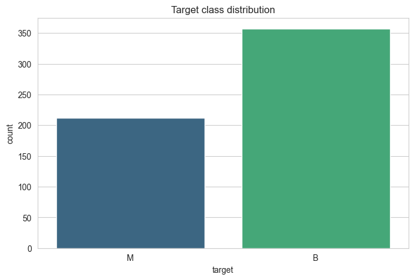
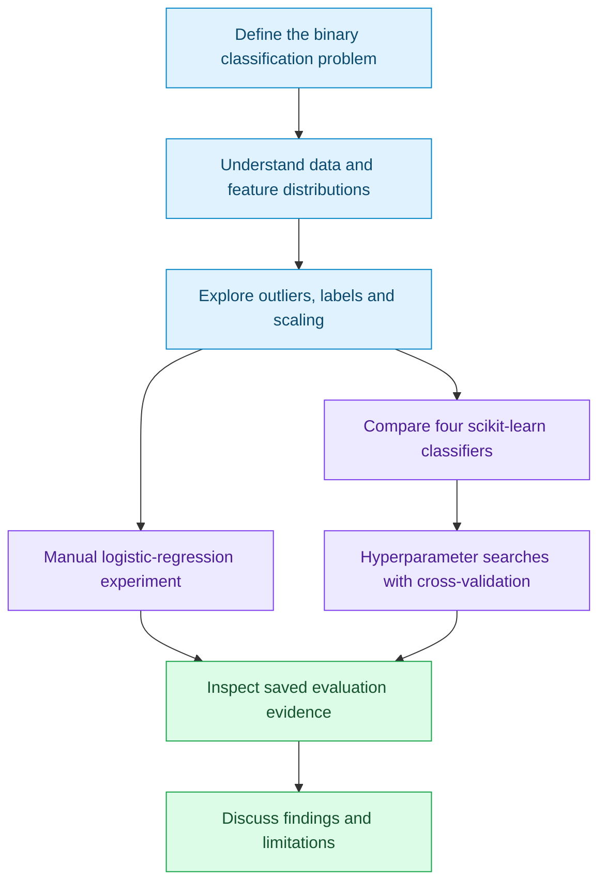
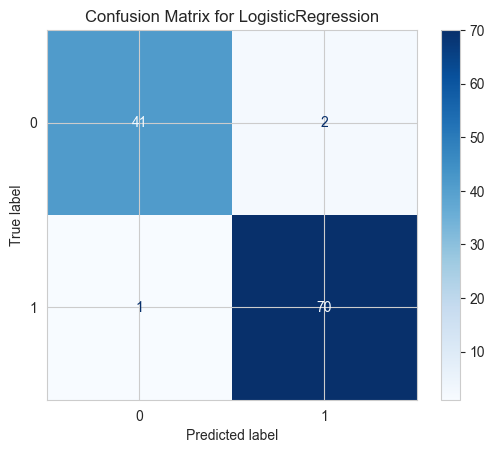

# Data Science for Applied AI

### Breast cancer classification: exploration, modelling and evaluation

**Samik Hafeez · Year 2 coursework · 2024–2025, Semester 1**

A notebook-based study of the Breast Cancer Wisconsin (Diagnostic) dataset, combining exploratory analysis, preprocessing experiments, a manually implemented logistic-regression model and comparisons of four scikit-learn classifiers.

[Original notebook](notebooks/breast_cancer_version4.ipynb) · [Written report](reports/Data%20science%20report.pdf) · [Methodology](#methodology) · [Saved results](#saved-results) · [Reproduction notes](docs/REPRODUCIBILITY.md)

---

## Project at a glance

| Area | Work represented in the source |
| :--- | :--- |
| Dataset understanding | Class counts, summary statistics, missing-value checks and feature relationships |
| Visual exploration | Histograms, heatmaps, scatter and pair plots, box plots, PCA, t-SNE, density and cumulative distributions |
| Data preparation | IQR-based outlier removal, label mapping and scaling experiments |
| Learning fundamentals | Manual logistic-regression implementation with gradient updates |
| Model comparison | Random Forest, SVM, K-nearest neighbours and Logistic Regression |
| Evaluation | Train/test accuracy, cross-validation searches, precision, recall, F1, ROC-AUC and confusion matrices |

The source dataset contains **569 observations and 30 features**. The notebook's initial class counts are **357 benign and 212 malignant**. Dataset features describe cell-nuclei measurements; this project analyses tabular features rather than training an image classifier. [Dataset source: UCI](https://archive.ics.uci.edu/dataset/17/breast+cancer+wisconsin+diagnostic).



*Extracted directly from the saved output of notebook cell 3; the notebook was not rerun.*

## Methodology

The written report explicitly uses **CRISP-DM** and describes five stages, excluding deployment. The diagram below summarises its analysis design. The notebook contains multiple experimental paths rather than one fully reproducible linear pipeline.



The UCI exploration removes observations flagged as outliers in more than two features, leaving **486 rows** in the saved output. Later cells also load the original dataset through scikit-learn, creating a separate modelling path. The [reproduction notes](docs/REPRODUCIBILITY.md) explain why their results should not be mixed into a single leaderboard.

## Saved results

The following values are transcribed from **notebook cell 55**, which defines an 80/20 split with `random_state=42`, fits a scaler on training data and compares four classifiers. They are historical outputs, not newly reproduced measurements.

| Baseline classifier | Saved training accuracy | Saved test accuracy |
| :--- | ---: | ---: |
| Random Forest | 100.00% | 96.49% |
| Linear SVM | 98.68% | 95.61% |
| K-nearest neighbours, k = 5 | 98.02% | 94.74% |
| Logistic Regression | 98.68% | 97.37% |

Other cells contain tuned-model results, PCA experiments and a separate final evaluation. Their execution counts are not in sequence, so they are retained in the notebook with the original context rather than treated as a verified improvement over this table.

### Existing evaluation visual



*Saved output from cell 60, a later evaluation section. In that section's scikit-learn encoding, class 0 is malignant and class 1 is benign. Earlier UCI cells use the reverse numeric mapping. This figure is separate evidence from the baseline comparison above.*

[View the original PCA projection](assets/pca-projection.png) · [Figure provenance](assets/provenance.json)

## Explore the notebook

Cell numbers below are one-based positions in the unchanged notebook, not its execution counters.

| Cells | Focus |
| :--- | :--- |
| 1–18 | Data loading, class distribution and feature exploration |
| 19–33 | Outlier identification, filtering and normalisation experiments |
| 34–41 | Further visualisation, PCA, t-SNE and distribution analysis |
| 43–53 | Train/test split, manual logistic regression, cross-validated logistic regression and PCA |
| 54–59 | Separate classifier comparison and hyperparameter searches |
| 60–61 | Final saved evaluation and unfinished follow-up comment |

## Open locally

The notebook metadata records **Python 3.11.7**. The dependency file provides a proposed compatibility environment, not a recovered lockfile from the original coursework computer.

```bash
python3.11 -m venv .venv
source .venv/bin/activate
python -m pip install -r requirements.txt
python -m jupyterlab notebooks/breast_cancer_version4.ipynb
```

The first data-loading cell fetches UCI dataset 17 through `ucimlrepo`, so it needs network access. A later comparison uses `sklearn.datasets.load_breast_cancer`. No separate dataset file was present in the supplied folder.

Review the saved notebook before executing it. The source includes nonsequential execution state, a retained error and expensive grid searches. A clean “Run All” has not been validated. See [reproduction notes](docs/REPRODUCIBILITY.md).

## Repository layout

```text
Data-Science-Applied-AI/
├── notebooks/          Original notebook, including outputs
├── reports/            Original written report
├── assets/             Three unchanged plots extracted from the notebook
├── presentation/       Recording information; video retained locally
├── docs/               Reproduction notes and source hashes
├── tools/              Static repository validation
├── .github/            Validation workflow and pull-request template
├── requirements.txt    Proposed notebook dependencies
└── README.md
```

The presentation recording is retained locally at `presentation/Data Science Presentation (1).mkv` and ignored by Git. See [presentation notes](presentation/README.md). The notebook and report are tracked and unchanged byte-for-byte.

## Scope and limitations

This is educational classification work, not a clinically validated diagnostic system. The source includes preprocessing before splitting in one path, different numeric label conventions, variable reuse across experiments and a saved error. Those details are documented rather than silently repaired. No new accuracy claim, model training or clinical validation was performed when preparing this repository.

[Contribution guide](CONTRIBUTING.md) · [Change log](CHANGELOG.md) · [Source preservation record](docs/source-artifacts.json)
